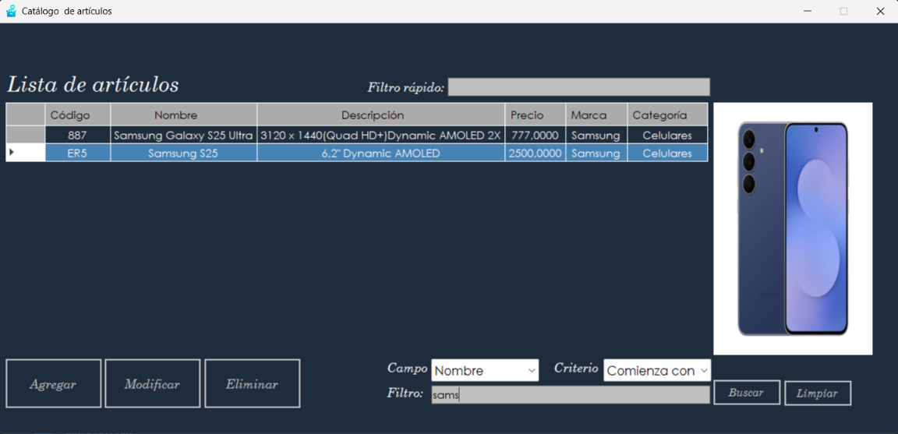

<div align="center">

# 🖥️ Catalog Manager

### Desktop Inventory Management Application

A desktop application developed with **C# and Windows Forms**, designed to manage products, organize inventory and perform advanced searches.


</div>

---

## 📸 Preview



---

## ✨ Features

- **Product Management:** Create, view, update and delete products.
- **Quick Search:** Find products easily by name.
- **Advanced Filters:** Search using specific criteria.
- **Product Details:** View information about each item.
- **Database Integration:** Store and manage data with SQL Server.

---

## 🏗️ Project Structure

The application is organized into separate projects:

| Project | Description |
|---------|-------------|
| **App Final** | Windows Forms user interface |
| **Control** | Business logic and data access |
| **Model** | Domain entities and models |

---

## 🛠️ Technologies

- C# / .NET
- Windows Forms
- SQL Server
- Visual Studio
- Object-Oriented Programming (OOP)

---

## 🚀 Getting Started

1. Clone the repository:

   ```bash
   git clone https://github.com/nicodev404/Catalog-manager.git
   ```

2. Open the `.sln` file in Visual Studio.
3. Configure the SQL Server database connection.
4. Set the Windows Forms project as the startup project.
5. Run the application using `F5`.

> **Note:** A local SQL Server database configuration is required.

---

<div align="center">

### 👨‍💻 Developed by nicodev404

[GitHub Profile](https://github.com/nicodev404)

</div>


